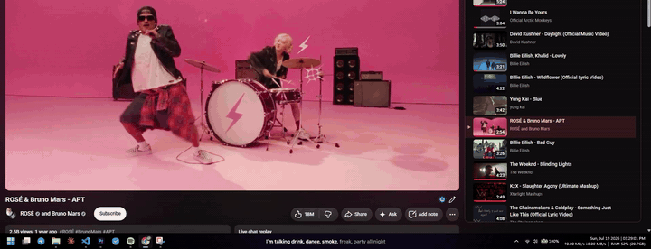
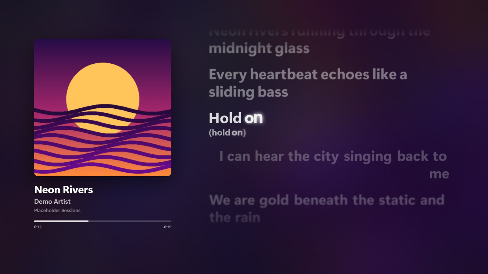
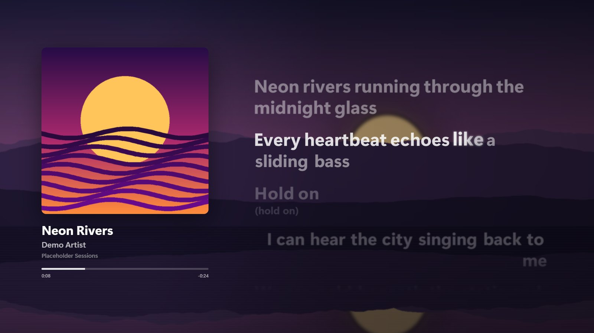
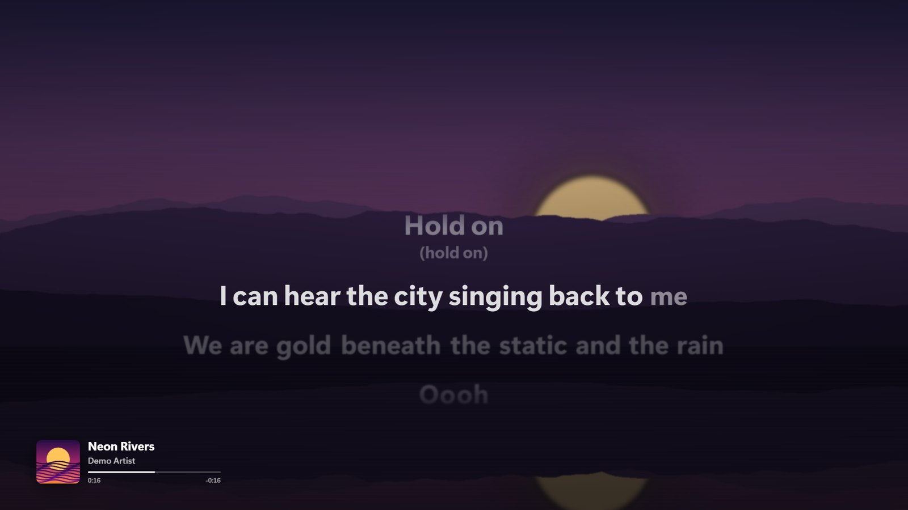
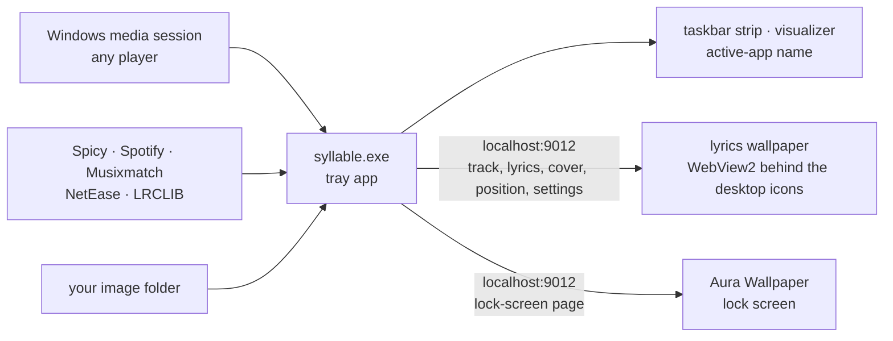

# Syllable

Word-by-word synced lyrics for whatever is playing on Windows — Spotify, YouTube in a
browser, anything that shows up in the Windows media flyout — drawn on the taskbar, and
full-screen as a **lyrics wallpaper** on the desktop and the lock screen.

Free and open source. No subscription, no account, no telemetry.



| Desktop — album gradient | Desktop — your own images |
|---|---|
|  |  |

| Lock screen |
|---|
|  |

<sub>Shots use the wallpaper's built-in demo page: placeholder lyrics, generated cover and
background. The empty top third of the lock screen is where Windows draws its own clock.</sub>

## Features

- **Taskbar strip** — the current line with a per-syllable sweep, background vocals
  ("yeah", "come on") as a smaller row, ● ● ● during instrumental gaps. Click-through,
  placed anywhere along the top or bottom edge, on or above the taskbar, and it can step
  aside while the desktop is showing.
- **Lyrics wallpaper, hosted by the app** — no Wallpaper Engine needed. Syllable draws the
  page itself, on every monitor, behind your desktop icons: word gradient sweep with glow,
  letter-by-letter emphasis on held notes, blur on lines away from the current one,
  right-aligned duet lines, interlude dots, beside a now-playing card with cover, title and
  progress.
- **Backgrounds** — a random image from your folder on every song change (no repeats until
  the folder has been through, filterable by collection), or the animated, bass-reactive
  album-cover gradient.
- **Lock screen** — its own layout: lyrics centred under Windows' clock with a compact
  now-playing strip, drawn by [Aura Wallpaper](https://store.steampowered.com/app/2726120/)
  loading Syllable's page. Keeps going while the PC is locked.
- **Word-level lyrics without a Spotify mod** — Musixmatch richsync and NetEase YRC give
  per-word timing for any player, with LRCLIB for line-level fallback. A Spicy Lyrics API
  key or a Spotify sign-in can be added, but nothing has to be installed into Spotify.
- **Extras on the taskbar** — an album-coloured audio visualizer fed from WASAPI loopback,
  and a macOS-style active-app name.
- **One settings window** — every option in one place, applied instantly, reachable from
  the tray icon (♪).

## Requirements

- Windows 10 or 11 (the wallpaper host handles both the pre-24H2 and 24H2+ desktop layouts)
- [WebView2 runtime](https://developer.microsoft.com/microsoft-edge/webview2/) — already
  present on an up-to-date Windows 11
- To build: a [Rust toolchain](https://rustup.rs) (stable, MSVC target)

## Build

```powershell
git clone https://github.com/kamol1dn/syllable-desktop
cd syllable-desktop
cargo build --release
```

The app is `target\release\syllable.exe`, self-contained apart from WebView2. A debug build
(`cargo build`) keeps a console window showing the log.

To start it with Windows, put a shortcut to the exe in `shell:startup` (Win+R →
`shell:startup`).

## Setup

**The app.** Run `syllable.exe`; it sits in the tray (♪) and the lyrics strip and wallpaper
come up on their own. Everything else is in **Settings…**.

**Backgrounds.** Point Settings at a folder of images, or switch the background to the
animated album gradient.

**Lock screen (optional).** Install
[Aura Wallpaper](https://store.steampowered.com/app/2726120/) from Steam, then set its
*Lockscreen Wallpaper* to the address Syllable's settings window shows for the lock-screen
page. Settings reports whether Aura is installed and whether the page is showing.

**Extra lyric sources (optional).** Under accounts in Settings you can add a Spicy Lyrics
developer API key, sign in to the Spotify web player, or connect your own Spotify app
(Client ID with PKCE, redirecting to `http://127.0.0.1:9013/callback`). Keys and tokens are
stored in `%LOCALAPPDATA%\Syllable\secrets.dat`, encrypted with DPAPI for your user
account, and never leave the machine except to the service they belong to.

## Where lyrics come from

The cache is tried first, then every configured provider is asked at once and the best
answer wins — word timing beats line timing, and within the same kind the earlier source
wins:

| order | source | timing | needs |
|---|---|---|---|
| 1 | Spicy Lyrics API | word | a developer API key |
| 2 | Spotify | word | a web-player sign-in or your own Spotify app |
| 3 | Musixmatch | word (richsync) | nothing |
| 4 | NetEase | word (YRC) | nothing |
| 5 | LRCLIB | line | nothing |

Titles like `Artist - Title (Official Video)` are cleaned up before searching, results that
are clearly another song are thrown away, and the answer is final as soon as no provider
still running could beat it.

## How it works



Each part is its own crate and they talk only through an event bus, never to each other:

| crate | owns |
|---|---|
| `core` | shared contracts: models, config, event bus, playback clock, audio slot, log |
| `media` | Windows media session (SMTC): track, artwork, position |
| `lyrics` | lyric providers, cache, secrets, optional Spotify sign-in |
| `taskbar` | lyrics strip and active-app name, docked into the taskbar |
| `audio` | WASAPI loopback capture and spectrum |
| `wallpaper` | local feed server and the WebView2 host behind the desktop icons |
| `settings` | settings window and style presets |
| `app` | `main`, module start-up, tray icon, message loop |

There is no async runtime: blocking I/O on worker threads keeps the binary small. The
wallpaper page is plain HTML/CSS/JS in `assets/wallpaper/` with no build step, and the feed
on port 9012 stays open, so a browser tab or another wallpaper host can show the same page.
[ARCHITECTURE.md](ARCHITECTURE.md) has the details.

## Files it writes

| path | what |
|---|---|
| `%LOCALAPPDATA%\Syllable\config.json` | every setting |
| `%LOCALAPPDATA%\Syllable\log.txt` | the log |
| `%LOCALAPPDATA%\Syllable\cache\` | resolved lyrics |
| `%LOCALAPPDATA%\Syllable\secrets.dat` | API keys and tokens, DPAPI-encrypted |

## Support

Syllable is free, and I would rather keep it that way than put a subscription on it. If it
earns a coffee, donations are welcome — but nothing is paywalled, now or later.

<!-- Donation link goes here. -->

## License

[GPL-3.0](LICENSE). Use it, fork it, ship your own version — keep it open.
